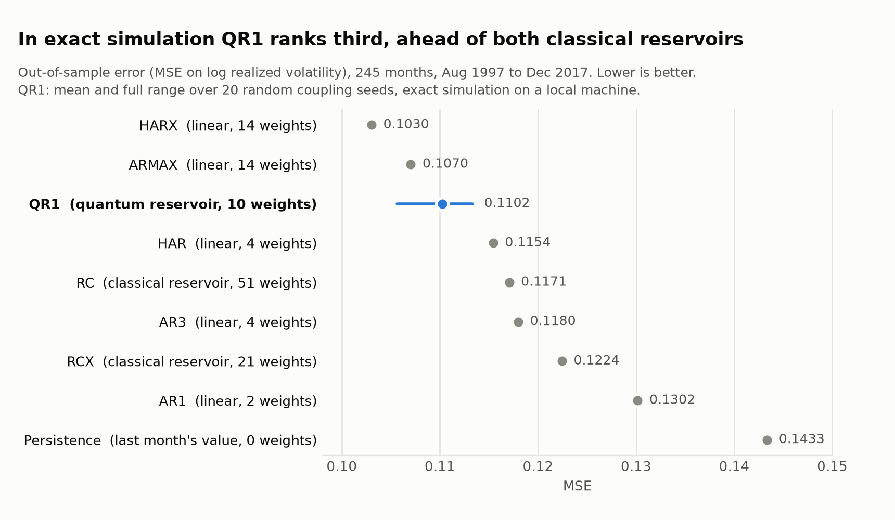
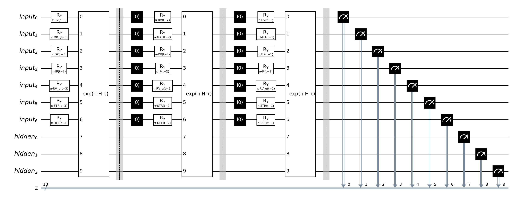
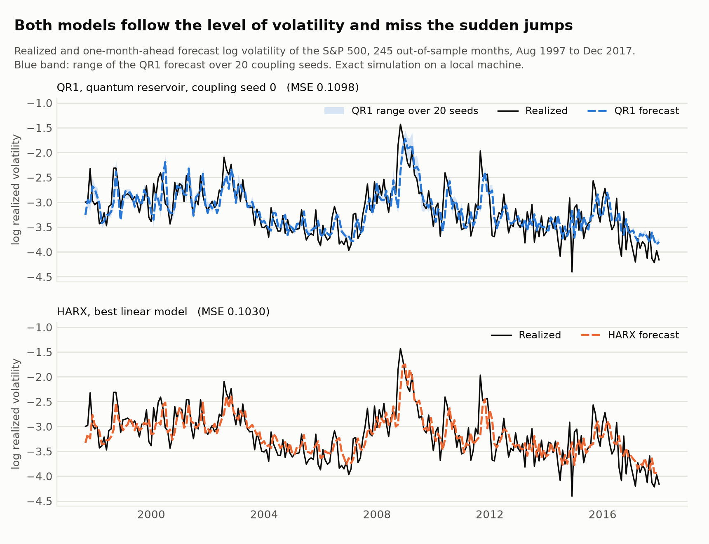
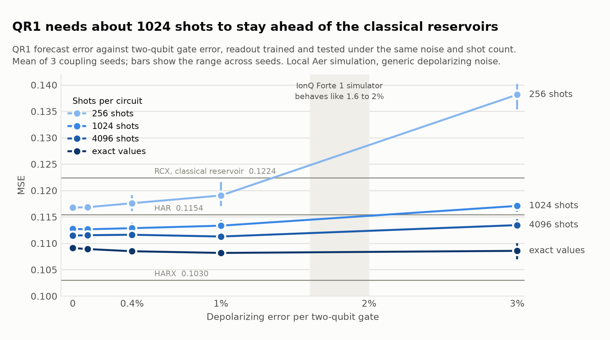
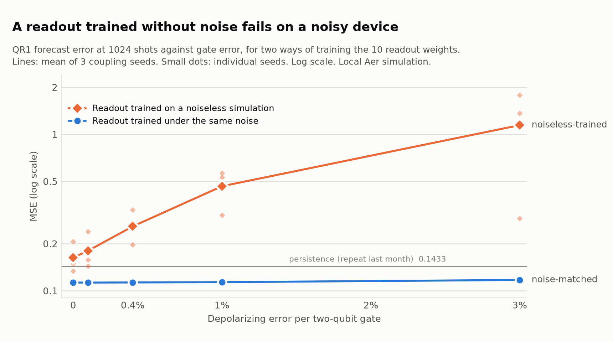
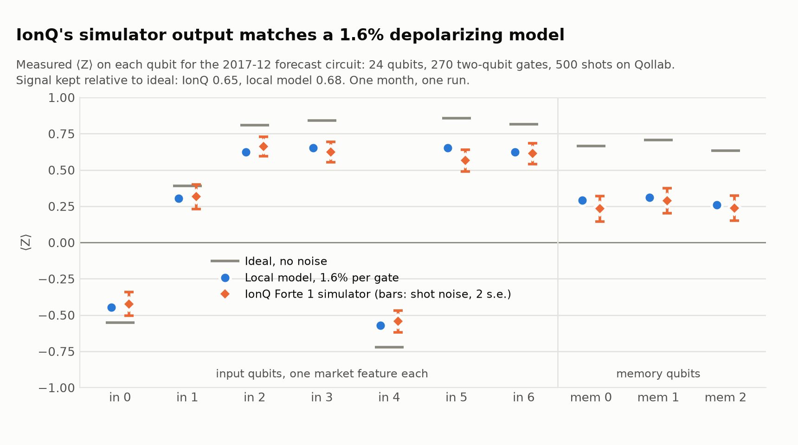
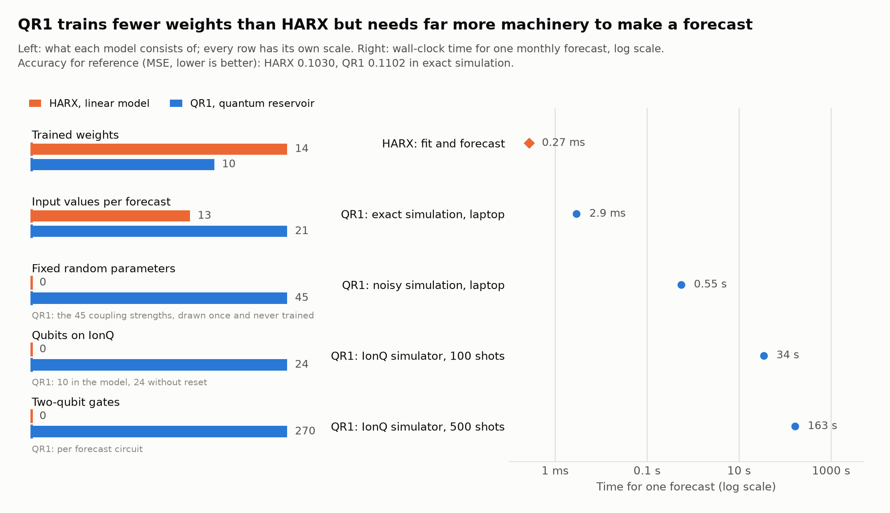
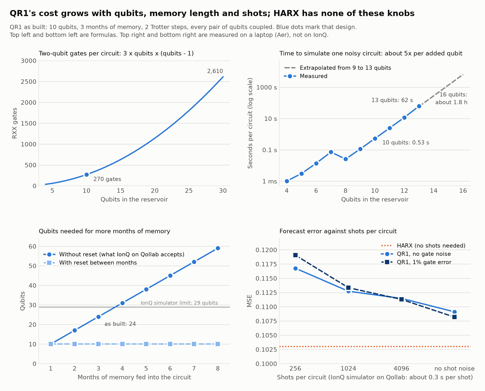
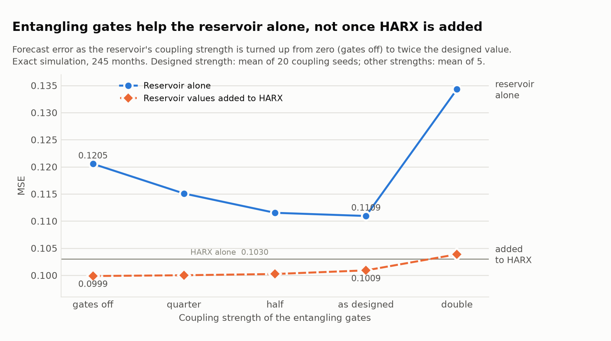

# Quantum Reservoir Computing for Realized Volatility

A reproduction and stress test of Li et al.'s quantum reservoir computing (QRC) benchmark
for S&P 500 monthly realized volatility, built for the Qollab × IonQ Hackathon 2026
(theme: Quantum Impact). The repository contains the paper's classical benchmarks
replicated in Python on freshly pulled open data, the 10-qubit quantum reservoir QR1
rebuilt in Qiskit, a study of how it holds up under shots and gate noise, and an entry
point that runs it on IonQ's simulator through Qollab.

**What we found**

- **A fair test changes the ranking.** QR1 is given macro variables as well as past
  volatility. Among the four models with those inputs it ranks third in exact simulation:
  behind two linear models (HARX, ARMAX), ahead of the classical reservoir RCX, with the
  fewest trained weights (10). The gap to HARX is not statistically significant on 245
  months. Given past volatility only, a quantum reservoir trails HAR and the classical
  reservoir.
- **On a noisy device the readout must be trained under matching noise.** A readout trained on
  a noiseless simulation fails; a noise-matched one keeps most of the accuracy, given about
  1,000 shots per circuit. One calibration circuit was enough to match IonQ's Forte 1
  simulator with a generic 1.6% depolarizing model.
- **The quantum dynamics help the reservoir alone, not a hybrid.** Switching the entangling
  gates off makes QR1 9% worse on its own. Added to HARX, the reservoir's benefit comes
  entirely from its input encoding, a classical transform.
- **This is not a quantum-advantage claim.** Nothing here ran on quantum hardware, and ten
  qubits are simulated exactly on a laptop in milliseconds.

See `docs/submission_summary.md` for the summary by judging criterion and
`DISCLOSURES.md` for prior work, libraries, data sources and AI assistance.



Reference paper: Qingyu Li, Chiranjib Mukhopadhyay, Abolfazl Bayat, Ali Habibnia,
"Quantum Reservoir Computing for Realized Volatility Forecasting",
[arXiv:2505.13933v2](https://arxiv.org/html/2505.13933v2).
The authors' code is at
[LeeQY1996/Quantum-Reservoir-computing-for-Realized-Volatility-Forecasting](https://github.com/LeeQY1996/Quantum-Reservoir-computing-for-Realized-Volatility-Forecasting);
several findings below come from auditing that repository, and this project cites it
as the source of the benchmark protocol.

```bibtex
@article{li2025qrcrv,
  title   = {Quantum Reservoir Computing for Realized Volatility Forecasting},
  author  = {Li, Qingyu and Mukhopadhyay, Chiranjib and Bayat, Abolfazl and Habibnia, Ali},
  journal = {arXiv preprint arXiv:2505.13933v2},
  year    = {2025}
}
```

## Setup

Python 3.14 is required to match the Qollab runtime. The environment is managed with
`uv`, and `pyproject.toml` is the single source of truth for dependencies:

```bash
uv sync
.venv/bin/python -c "import qiskit, sklearn, reservoirpy; print('ok')"
```

Qiskit is pinned to `>=2.5.2,<3.0.0` to match Qollab's runtime default, and
`qiskit-aer==0.17.2` matches Qollab's PQCA library pin. The packages `xlrd` and
`reservoirpy` are local-only (neither has a Pyodide build) and must stay out of the
Qollab `requirements.txt`, which lists Qiskit only; the Qollab demo runs inference-only
with frozen weights.

Run the tests with `uv run --with pytest python -m pytest tests -q`.

## Run it on Qollab

1. Build the upload: `uv run python scripts/make_qollab_zip.py` writes `qollab_qr1.zip`, the
   nine files a run needs (`main.py`, `requirements.txt`, `demo/qr1_demo.json` and four
   modules under `src/qrc/`). The whole repository also fits Qollab's limits if you prefer
   to upload it as it is.
2. Create a Qollab project from the zip, with `main.py` at the top level.
3. Pick a backend in Select QPU, set the fields below and run.

Each run builds one forecast circuit, submits it as one job, and shows, in order: the
story in five lines with a figure of the three headline findings; the circuit; the ten
values measured on the quantum device next to their ideal values; the forecast those give
through both readouts (noise-matched and not) and through the hybrid readout that adds
them to HARX's inputs, next to the classical models' forecasts; actual against predicted
over all 245 months for the reservoir, HARX and the hybrid; and the full benchmark table. Figures are drawn with matplotlib; if they cannot be shown, or
with `plots` off, the same content is printed as text charts. Nothing is trained during the run; `main.py`'s header explains what runs
where.

| Field | Meaning |
| --- | --- |
| `shots` | Shots for the circuit (default 1024) |
| `month` | Forecast month: `2017-10`, `2017-11` or `2017-12` |
| `all_three_months` | Run all three months in one job (built-in simulator only) |
| `mid_circuit` | On IonQ backends, measure each earlier month's input qubits mid-circuit |
| `plots` | Show figures (default on); text charts when off |

- **Built-in simulator:** the 10-qubit circuit, with the input qubits reset between months.
- **IonQ backends:** these reject `reset` and take one circuit per job, so they get an
  equivalent 24-qubit circuit in which each month has its own input qubits, and readout
  weights trained under matched noise. A 500-shot run on the IonQ Forte 1 simulator took
  about 160 seconds; the runs are recorded in `data/ionq_runs.json`.

To reproduce a Qollab run on a laptop:
`uv run python scripts/run_demo_local.py [--shots 1024] [--month 2017-12] [--as-ionq]`.

## Data

`scripts/pull_data.py` rebuilds the paper's monthly panel from open, keyless sources:
S&P 500 daily closes from the Yahoo Finance chart API (monthly log realized volatility
plus quarterly/annual averages), Fama–French monthly factors from the Kenneth French
data library, dividend/earnings/CPI histories from Shiller's `ie_data.xls`, and
industrial production, T-bill, and default-spread series from FRED. The output is
`data/rv_monthly.csv`: 816 months (January 1950–December 2017) by 15 columns, about
173 KB, comfortably inside Qollab's 2 MB per-file cap.

The downloaded panel was validated column-by-column against the authors' `Data.CSV`.
The RV, T-bill, default-spread, and market-factor series are identical up to the
authors' normalization; dividend, earnings, size, value, reversal, and production
series match up to small data-vintage revisions (R² > 0.9999); the inflation series is
related but comes from a different CPI variant (ρ ≈ 0.88), which is immaterial at its
scale. No data difference affects any benchmark conclusion.

## Replicated benchmarks

`scripts/bench_classical.py` implements the AR1/AR3/ARMAX/HAR/HARX OLS benchmarks and
a teacher-forced echo-state baseline under the paper's rolling protocol: a fixed
estimation window, refitting every month, 245 one-step-ahead out-of-sample forecasts
from August 1997 to December 2017. `scripts/bench_rc.py` additionally ports the
authors' exact reservoir code — a 3-step stateless echo-state network reset per sample
with `Ridge(1e-7)` readout — to the installed reservoirpy version. OOS predictions are
saved to `data/oos_classical.csv`, which is the comparison harness the quantum models
will drop into. Metrics follow the authors' code: mean squared error on log realized
volatility, and QLIKE as the Patton loss summed over the out-of-sample period on
absolute log volatility (this differs from the formula printed in the paper and was
verified numerically).

The table below scores each model the way the authors' code does, to show that their
numbers are reproduced. It is not the ranking we report: see "Results" for the scores
with every forecast aligned to the right month.

| Model         | This repo (MSE / QLIKE)  | Paper Table 2   | Assessment                                             |
| ------------- | ------------------------ | --------------- | ------------------------------------------------------ |
| AR1           | 0.1302 / 1.7172          | 0.1304 / 1.7279 | Reproduced                                             |
| AR3           | 0.1180 / 1.5892          | 0.1178 / 1.5893 | Reproduced                                             |
| HAR           | 0.1479 / 2.0387          | 0.1476 / 2.0431 | Reproduced via the off-by-one finding below            |
| HARX          | 0.1466 / 2.08            | 0.1508 / 2.24   | Structure replicated; small residual from data vintage |
| ARMAX         | 0.1070 / 1.4460          | 0.1145 / 1.6196 | Close; partly different estimator (OLS vs ARIMA)       |
| RC, 50 units  | 0.141–0.153 across seeds | 0.1441 / 2.1011 | Reproduced (their draw lies in-distribution)           |
| RCX, 20 units | best 0.125 observed      | 0.1089 / 1.6480 | Not reproduced; see finding 5                          |

## Findings from auditing the authors' repository

1. The HAR/HARX rolling loop predicts row `end` but evaluates against test rows starting
   at `end+1`, misaligning every forecast by one month. Reproducing that exact
   misalignment reproduces their HAR numbers to three decimals, so their HAR appears
   worse than AR3 for an implementational reason, not a modeling one.
2. The code runs the classical reservoir with `input_scaling=1`, while the paper text
   states 0.1. The code value is what reproduces Table 2.
3. The classical reservoir is a 3-step stateless network (fresh zero state per sample,
   last state kept), not a continuously teacher-forced one.
4. No random seeds are set anywhere in their code, and the files `dff.csv`,
   `Data_raw.csv`, and the differencing script are absent from the repo, so
   point-exact reproduction of the stochastic models is impossible; distributional
   agreement is the achievable standard. HARX additionally uses an undocumented
   293-observation window with four exogenous inputs.
5. The reported RCX value (0.1089) was not reached in any of 15+ draws across two
   independent implementations (best observed 0.125). It should be treated as an
   optimistic draw. The quantum comparison in this project will therefore use our own
   RCX run under the identical protocol rather than the printed number.

## Quantum reservoir model (QR1)

QR1 uses 10 qubits: seven input qubits, one per market feature (RV, MKT, DP, IP, RV_q,
STR, DEF), and three memory qubits. For each forecast it loads three months of features,
oldest first, with `RY(π·x)` rotations, lets all ten qubits evolve under a fully connected
transverse-field Ising Hamiltonian after each month, discards the input qubits between
months, and measures ⟨Z⟩ on all ten at the end. A ridge regression with ten weights turns
those values into the forecast. The couplings are random and never trained.
`docs/qrc_spec.md` is the full specification.



There are three implementations, checked against each other by `tests/test_qrc.py`:

- an exact NumPy reference (`src/qrc/reference.py`), which reproduces the authors' saved
  forecasts to 1.2e-6 when given their couplings;
- the Qiskit circuit with second-order Trotter steps (`src/qrc/circuit.py`): 10 qubits,
  270 two-qubit gates at two steps per month;
- the 24-qubit layout without reset, which gives the same output distribution.

## Results

Out-of-sample MSE on log realized volatility, 245 months (August 1997 to December 2017),
every forecast aligned to the month it predicts. Lower is better. QR1 is exact simulation.

Models are grouped by what they are given, because macro variables are worth a lot here
(they take HAR from 0.1154 to 0.1030). Comparisons are like for like only within a group.

| Model | Inputs | MSE | Trained weights |
| --- | --- | --- | --- |
| HARX (linear) | volatility + macro | 0.1030 | 14 |
| ARMAX (linear) | volatility + macro | 0.1070 | 14 |
| **QR1 (quantum reservoir, mean of 20 coupling seeds)** | volatility + macro | **0.1102** | **10** |
| RCX (classical reservoir) | volatility + macro | 0.1224 | 21 |
| HAR (linear) | volatility only | 0.1154 | 4 |
| RC (classical reservoir) | volatility only | 0.1171 | 51 |
| AR3 (linear) | volatility only | 0.1180 | 4 |
| **QR-uni (quantum reservoir, mean of 20 coupling seeds)** | volatility only | **0.1184** | **5** |
| AR1 (linear) | volatility only | 0.1302 | 2 |

QR1 ranges from 0.1056 to 0.1133 across the 20 seeds; the paper's 0.1051 is at the
favourable edge. RC and RCX are scored on the forecast averaged over 8 seeds; scored the
same way, QR1 is 0.1083.

**At equal size.** HARX and ARMAX cut to 10 weights (six of their ten macro variables, the
subset chosen on months before the test period) score 0.1065 and 0.1121, so at equal
weight count QR1 is level with ARMAX and closer to HARX. Restricted to the five macro
variables QR1 itself uses (9 weights), they score 0.1010 and 0.1044: with the same
information the linear models are more accurate (`scripts/bench_reduced.py`).

**Volatility only.** Without macro variables HARX is HAR and ARMAX is AR3. QR-uni is QR1's
reservoir fed past volatility alone; we tried four designs and report the best (1 input
qubit, 3 memory qubits, 12 months fed in). It matches AR3 and trails HAR and the classical
reservoir RC; no seed of any design beat HAR except one seed of the 10-qubit design. Its
entangling dynamics do help here (0.1297 with the gates off), by carrying memory across
months (`scripts/bench_univariate.py`).



### Robustness checks

Each asks whether the ranking changes in a setting that might favour the reservoir. None
does in a way that persists.

| Check | Result | Script |
| --- | --- | --- |
| Same lags on both sides (monthly, 1 to 12 lags) | An autoregression is ahead at every lag count; the reservoir gets within 2% of 12 lags with 5 weights instead of 13 | `bench_univariate.py --lags` |
| Shorter training windows (monthly, 24 to 240 months) | Plain least squares collapses, but a ridge-tuned HARX beats QR1 from 36 to 120 months; QR1 is 2% ahead only at 24 months and level at 240 | `bench_windows.py` |
| Daily forecasts (2,013 test days, 2010 to 2017) | HAR 0.1749, best reservoir 0.1760; HAR with yesterday's return 0.1645. The reservoir cannot use the return's sign | `bench_daily.py` |
| Little history and little data (daily, 125 to 250 training days, 1 to 5 days fed in) | A 4-qubit reservoir is within 2% of an autoregression and a same-size classical reservoir; the one significant edge (1%) disappears at 6 and 8 qubits | `bench_daily_lowdata.py` |

The daily data is the S&P 500 from Yahoo Finance, 2000 to 2017, with daily volatility from
the Garman-Klass range estimator (`data/spx_daily.csv`).

### Shots and gate noise

Simulated locally on Qiskit Aer with a generic depolarizing model (not IonQ's noise
model). The readout is trained and tested under the same noise and shot count; mean of
three coupling seeds.

| Error per two-qubit gate | 256 shots | 1024 shots | 4096 shots | No shot noise |
| --- | --- | --- | --- | --- |
| 0 | 0.1168 | 0.1127 | 0.1115 | 0.1091 |
| 0.4% | 0.1176 | 0.1129 | 0.1116 | 0.1085 |
| 1% | 0.1191 | 0.1133 | 0.1113 | 0.1082 |
| 3% | 0.1382 | 0.1171 | 0.1134 | 0.1086 |

With a readout trained on a noiseless simulation instead, the error at 1024 shots rises
to 0.47 at 1% and 1.14 at 3%.





### On IonQ's simulator

The forecast circuit (24 qubits, 270 two-qubit gates, 500 shots) was run on the IonQ
Forte 1 noise-model simulator for three months. We set the local noise level, 1.6% per
two-qubit gate, from the 2017-12 run, then ran 2017-10 and 2017-11 without changing it.
In all three the simulator kept 0.63 to 0.66 of the ideal signal, against 0.68 to 0.69
for the model, and the measured values agree with the model within shot noise.

| Forecast month | QR1 on IonQ's simulator, error | QR1 noiseless, error | HARX, error |
| --- | --- | --- | --- |
| 2017-10 | +0.65 | +0.45 | +0.28 |
| 2017-11 | +0.22 | +0.17 | +0.04 |
| 2017-12 | +0.48 | +0.41 | +0.20 |

Errors are forecast minus realized log volatility. Three months show that the pipeline
runs and what the device adds to the error; they are not evidence about accuracy.



### Cost and scaling

QR1 trains fewer weights than HARX and needs far more to produce a forecast: under a
millisecond for HARX against minutes on a simulator for QR1. Its gate count grows with
the square of the number of qubits, and classical simulation time grows about fivefold
per added qubit.





### Where the value comes from

Running the same model with the entangling gates removed isolates what the quantum dynamics
contribute. With the gates off, each input qubit returns cos(π·x) of its feature, a classical
transform.

| Model | Entangling gates off | As designed (mean of 20 seeds) |
| --- | --- | --- |
| Reservoir alone | 0.1205 | 0.1109 |
| Reservoir values added to HARX's inputs | 0.0999 | 0.1009 |

- **Alone, the dynamics help:** 8% lower error, on all 20 seeds, p = 0.04. A linear regression
  on the same seven inputs still does better (0.1082), so the dynamics appear to recover
  information that the encoding discards.
- **In a hybrid with HARX, they do not:** the gates-off version is at least as good. The gain
  over HARX (0.1030) comes from the cosine of two signed inputs, the market return and the
  reversal factor, which measures the size of last month's move. A plain square does the same
  (0.1010).
- The hybrid gains are 2 to 3% and not statistically significant on 245 months.



### What did not help

Each was tested in exact simulation and none beat its control: amplitude damping added to
the evolution, a continuous-stream reservoir whose memory qubits are never reset (0.1105
against 0.1109), reading the discarded input qubits as extra features (0.1138 against 0.1109),
and four ways of getting more out of the reservoir in the hybrid (qubit correlators, temporal
multiplexing, extra measurement bases, Hamiltonian encoding).

All figures, with alt text, are in `docs/figures/`.

## Layout

```
main.py                 Qollab entry point: one circuit, one job, frozen readout
demo/qr1_demo.json      inputs, frozen weights and tables read by main.py
requirements.txt        Qollab requirements (Qiskit only)
src/qrc/                QR1: features, exact reference, circuit, noise models, readout
src/harness.py          data panel, rolling folds, OLS models, scoring
tests/test_qrc.py       acceptance tests for QR1
scripts/                every experiment and figure; scripts/README.md lists them by topic
data/                   the monthly and daily data, and every result as CSV or JSON
docs/qrc_spec.md        QR1 specification, noise models, results
docs/submission_summary.md   summary by judging criterion
docs/project_page.md, docs/video_script.md   submission text
docs/figures/           figures and alt text
DISCLOSURES.md          prior work, libraries, data, AI assistance
```

## License

MIT; see `LICENSE`. The license covers the code in this repository, not the underlying
data sources (see `DISCLOSURES.md`).

This effort is supported by Qollab & IonQ.
